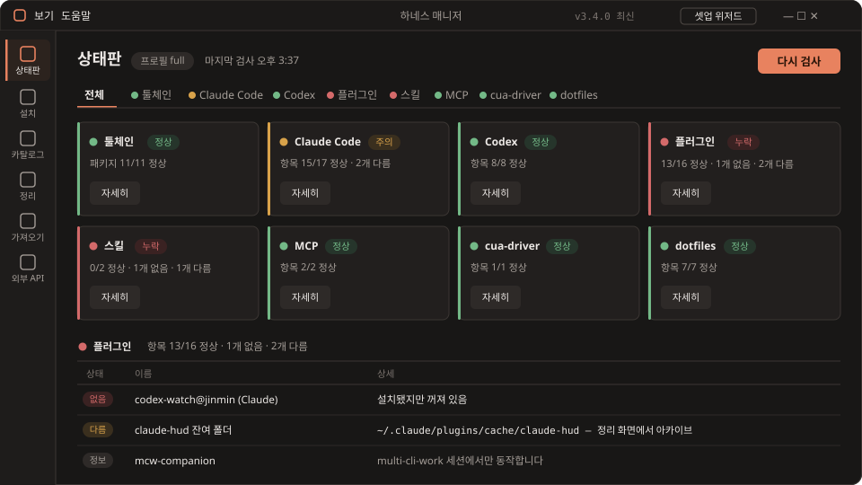
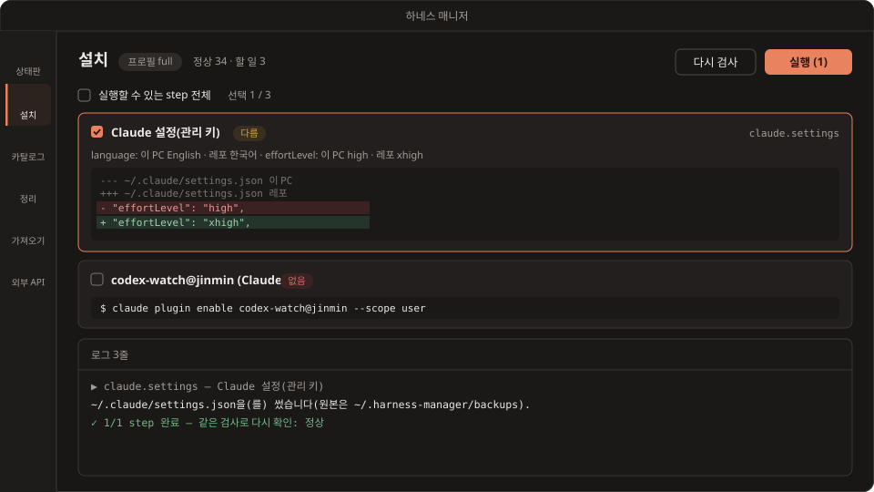
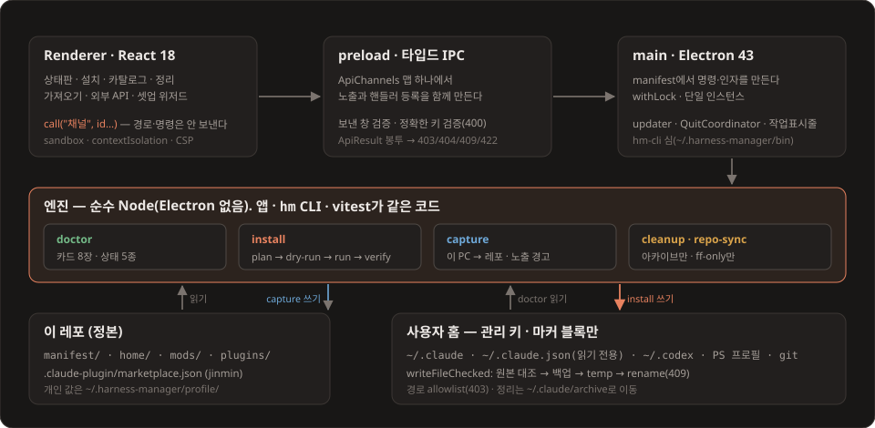

<p align="center">
  
</p>

<p align="center">
  
  
  
  
  
  
</p>

**하네스 매니저**는 새 PC에서도 **같은 Claude Code · Codex 개발환경**을 만드는 **로컬 전용 Windows · Ubuntu 데스크톱 앱**(Electron)이다. 앱 소스와 사용자 프로필을 구분하며, 선택한 프로필의 manifest에 따라 툴체인, Claude Code · Codex 설정, 플러그인 · 스킬, MCP, 셸 · git dotfiles를 구축한다.

- 첫 화면 **상태판**이 카드 8장으로 무엇이 되어 있고 무엇이 빠졌는지 보여 준다. 상태는 초록 · 노랑 · 빨강 점과 글자 라벨로 함께 표시한다.
- **설치**는 manifest 기반 step 엔진이다. plan → dry-run → run → verify 순서로 돌고, 이미 정상인 것은 건너뛰므로 몇 번을 돌려도 같다.
- **가져오기**는 반대 방향이다. 이 PC에서 바꾼 설정을 diff로 보고 선택한 개인 프로필로 가져온다.
- **셋업 위저드**는 두 겹이다. 앱의 8단계 위저드, 그리고 Claude에게 **"설치해줘"** 라고 하면 따르는 `jinmin-setup` 스킬. 둘 다 같은 `hm` CLI를 부른다.
- 사용자 설정은 통째로 덮어쓰지 않는다. JSON은 관리 키만, TOML은 관리 줄만, 텍스트 파일은 마커 블록만 고치고, 쓰기 전에 백업한다. 정리는 지우지 않고 아카이브로 옮긴다.

렌더러와 main은 로컬 IPC로 통신하며 네트워크 포트나 텔레메트리는 없다. 업데이트·설치·외부 API 조회는 관련 서비스에 연결한다. 사용자가 AI 복구를 요청하면 선택한 CLI의 서비스로 진단 문맥을 보내고, 공통 앱 수정은 검증 후 Git 원격 저장소에 커밋·푸시한다. 로그인은 사용자가 CLI에서 진행한다.

## 미리보기

<!-- 60초 소개 영상: HarnessManager_홍보_60s_github.mp4를 GitHub 웹에 올려 받은 user-attachments 주소를 이 자리에 한 줄로 둔다. -->

<p align="center"></p>

<p align="center"><em>상태판. 노랑 하나, 빨강 둘 — 카드를 누르거나 섹션 탭을 고르면 상태 · 이름 · 상세 표가 펼쳐진다.</em></p>

<p align="center"></p>

<p align="center"><em>설치. 고친 파일의 diff와 실행할 명령을 먼저 보여 주고, 고른 step만 실행한다. 실행 뒤에는 같은 검사로 다시 확인한다.</em></p>

## 빠른 시작

**설치본으로**

1. [최신 릴리스](https://github.com/rafaam11/harness-manager/releases/latest)에서 받는다.
   - Windows: `Harness-Manager-Setup-x.y.z.exe`. 서명하지 않은 빌드라 SmartScreen에서 **추가 정보 → 실행**으로 진행한다.
   - Ubuntu: x64는 `…-x64.AppImage`, aarch64는 `…-arm64.AppImage`. `chmod +x` 뒤 실행한다.
2. 앱은 번들된 공통 기본으로 시작한다. Git·Node·GitHub 계정·HM 소스 레포 없이 프로필을 만들고 진단·설치 미리보기를 사용할 수 있다.
3. 타이틀바의 **셋업 위저드**에서 사용자 프로필을 선택한다. 새 사용자는 개인 설정이 없는 **공통 기본**으로 시작하며, 개인 프로필을 만들거나 외부 폴더를 연결할 수 있다.

**소스 개발용 셋업**(Windows PowerShell, 설치본 사용에는 불필요)

```powershell
# git · gh · node 설치 → 클론 → 빌드 → doctor → install 미리보기
.\scripts\bootstrap.ps1          # -Run: 전부 실행 · -InstallApp: 최신 설치본 실행 · -DryRun: 출력만
```

**AI에게** — 이 레포를 연 Claude Code에서 **"설치해줘"** 라고 하면 `jinmin-setup` 절차대로 `hm doctor` → 프로필 묻기 → `hm install` 미리보기 → 확인받고 실행 → 로그인 안내 순서로 진행한다. 설정 파일을 직접 고치지 않고 모든 변경은 `hm`을 거친다.

**앱 실행에는 별도 Node.js가 필요 없다**(Electron 내장 런타임). CLI 설치에는 정상 Node 22.12 이상과 npm을 보존하며, 새 환경에만 NVM과 Node 22를 설치·활성화한다. MSI/NVM 혼재는 자동 정리하지 않는다. 설치 뒤 기존 터미널은 새로 열어야 PATH가 반영된다.

**업데이트는 자동이다.** 시작할 때 GitHub 릴리스를 조회해 새 버전이 있으면 배경에서 차등 다운로드(blockmap)하고, 끝나면 타이틀바 배지가 **재시작**으로 바뀐다. 누르면 무음 설치하고 다시 뜬다. 자동 확인이 실패하면 같은 자리에 **릴리스** 링크가 뜬다.

## 사용자 프로필

앱 소스와 사용자 설치 정의를 나눕니다. `core / dev / full`은 사용자 이름이 아니라 **선택한 프로필 안의 설치 범위**입니다.

| 종류 | 동작 |
|---|---|
| 공통 기본 | Git·Node·Claude Code·Codex를 다룹니다. 개인 모델, 권한, 플러그인, MCP, dotfiles는 지정하지 않습니다. |
| 개인 프로필 | 위저드에서 이름을 입력하고 현재 프로필을 복사합니다. 패키지·설정·플러그인을 본인 필요에 맞게 관리합니다. |
| 외부 폴더 | `manifest/`와 `home/`을 가진 프로필 폴더를 연결합니다. 별도로 클론한 비공개 Git 저장소도 사용할 수 있습니다. |
| 기존 레포 | 개발자 설정으로 연결한 레포에서 명시적으로 개인 사본을 가져옵니다. 기존 `legacy` 선택은 원본을 보존한 채 독립 개인 프로필로 이전합니다. |

로컬 개인 프로필은 `~/.harness-manager/profiles/<id>/definition/`에 저장됩니다. PC 전용 값은 그 옆 `local/`에 따로 두며 토큰·OAuth·로그인 파일은 복사하지 않습니다. 기존 프로필을 복사할 때 관리 중인 로컬 보완 설정도 새 `local/`로 복사합니다.

**가져오기(capture)**는 현재 PC의 변경을 선택한 프로필로 저장합니다. 공개할 수 없는 값은 로컬 보완 설정으로 분리합니다. 공통 기본은 읽기 전용이므로 개인 사본을 먼저 만듭니다. 프로필을 바꿔도 이전 프로필로 설치한 패키지나 관리 대상 밖 설정을 자동 삭제하지 않습니다.

프로필 화면에서 설치 항목·관리 키·개인 지침을 편집하고 변경 미리보기 후 저장합니다. 저장·받기만으로 PC에 설치하지 않습니다. 프로필은 보관·복원할 수 있으며 연결한 외부 폴더는 삭제하지 않습니다. 기존 프로필 ID와 선택 상태는 유지합니다.

**다른 PC로 이동**: `.hmprofile.json` 파일로 내보내고 새 프로필로 가져옵니다. 개인 지침과 Git 이름/이메일 등은 이동할 항목을 선택하고 기억합니다. 토큰·인증 파일·PC 고유 절대경로는 제외합니다.

**선택적 GitHub 동기화**: 프로필별 비공개 저장소를 앱에서 만들거나 연결합니다. Git·GitHub CLI는 이 기능을 선택할 때만 필요하며 브라우저 로그인은 GitHub CLI가 담당합니다. 앱 시작 때 원격 변경을 알리고, 보내기·받기는 diff 확인 후 수동 실행합니다. 충돌은 파일별로 선택하며 강제 push하지 않습니다. 원격이 공개로 바뀌면 동기화를 중단합니다.

## AI 설치 복구

실패한 항목에서 **Codex에게 해결 요청** 또는 **Claude Code에게 해결 요청**을 누릅니다. 여러 항목은 최대 3개까지 병렬 처리하며, 같은 설정이나 런타임을 수정하는 작업은 대기합니다. 작업별 로그와 중단 버튼을 제공합니다.

실행 전 안내에 동의하면 기존 CLI 로그인 계정으로 오류·설치 계획·최근 로그를 전달하고 **YOLO 모드**로 실행합니다. Codex는 `--dangerously-bypass-approvals-and-sandbox`, Claude Code는 `--dangerously-skip-permissions`를 사용합니다. 명령마다 확인받지 않으며 각 AI 프로세스는 사용자 계정 권한으로 동작합니다. 최대 3회 복구하고 매번 실제 상태를 재검사합니다.

기본 요청은 PC 복구만 수행합니다. **이번 요청에서 HM 앱 개선에도 기여**를 별도로 선택하면, 공통 소스를 독립 사본에서 수정하고 테스트·타입 검사·빌드 후 자기 fork에 커밋·push하여 공개 PR을 만듭니다. 관리자 모드를 명시적으로 켜고 쓰기 권한이 확인된 경우에만 dev 직접 push를 선택할 수 있습니다. 개인 프로필·원본 로그는 게시하지 않습니다. PC 복구와 기여 결과를 따로 표시하며 게시 실패는 사본을 보존해 재시도할 수 있습니다. 자동 태그·릴리스·병합은 수행하지 않습니다.

## 화면

### 상태판

manifest · 레포 템플릿 · 로컬 오버레이를 이 PC와 비교해 카드 8장을 만든다.

| 카드 | 보는 것 |
|---|---|
| 툴체인 | 프로필에 든 패키지가 PATH에 있는지(git · gh · nvm · ripgrep · uv · python · rustup · scoop …) |
| Claude Code | 전역 `CLAUDE.md`, `settings.json` 관리 키 |
| Codex | 전역 `AGENTS.md` 공개 섹션, `config.toml` 관리 키 |
| 플러그인 | 마켓플레이스 소스, provider별 활성, mod 의존성, claude-hud 잔여 폴더 |
| 스킬 | 외부 스킬, 깨진 링크, 플러그인으로 옮긴 스킬의 낡은 사본 |
| MCP | provider별 등록과 명령 |
| cua-driver | 설치 위치 |
| dotfiles | PowerShell 프로필 마커 블록, git 전역 설정 |

검사 상태는 **정상**(초록) · **다름**(노랑) · **없음 · 오류**(빨강) · **정보**(회색) · **건너뜀**(프로필 밖) 다섯이다. 카드 색은 빨강 > 노랑 > 초록 > 회색 순으로 가장 급한 것을 따른다. 사용자 프로필은 위저드나 `hm profiles`로, 그 안의 설치 범위(core · dev · full)는 `hm settings`로 고른다.

### 설치

step은 doctor 검사에서 만든다. id 체계가 같아서 실행 뒤 같은 검사로 다시 확인한다. 실행 순서는 패키지 → 도구 → 전역 CLAUDE.md · AGENTS.md → Claude 설정 · 마켓플레이스 · 플러그인 → Codex → MCP → 외부 스킬이다.

- 각 step은 실행할 명령이나 고칠 파일의 diff를 미리 보여 준다. 렌더러는 step id만 보내고, 명령과 인자는 main이 manifest에서 만든다. 셸을 쓰지 않는다.
- 파일 merge — JSON은 관리 키만 deep-merge(문자열 배열은 합침), TOML은 관리 키 줄만 바꾸고 주석 · 순서를 보존, 마크다운 · PS 프로필은 `>>> harness-manager >>>` 마커 블록만.
- 같은 이름 마켓플레이스의 소스가 다르면 remove → add 하고, 빠진 플러그인을 같은 step에서 다시 설치한다.
- MCP env 자리표시는 실행 환경에서 채우고, 값은 미리보기와 로그에서 가린다.
- 한 step이 실패해도 다음 step은 계속한다. 진행은 로그 터미널과 작업표시줄 막대로 보이고, 설치 중 종료는 먼저 묻는다.

### 가져오기

이 PC → 선택한 사용자 프로필. 대상은 전역 AGENTS.md · CLAUDE.md, Claude · Codex 관리 키, 마켓플레이스 · 플러그인, MCP, 외부 스킬, PowerShell 프로필, git 전역 설정이다.

- 항목마다 diff를 보고 고른 것만 쓴다. 렌더러는 대상 id와 미리보기 지문만 보내고, main이 다시 계획해 지문이 같을 때만 쓴다.
- 개인 값(이메일 등)은 선택한 프로필의 PC 전용 `local/`로 보낸다(legacy는 `~/.harness-manager/profile/`). 공개 파일에 홈 경로 · 절대경로 · 이메일 · 비공개 낱말이 남으면 **노출 경고**로 적용을 막는다. 비공개 낱말 목록은 앱이 빈 배열로 초기화하며 가져오기 화면에서 편집한다. 파일을 직접 만들 필요는 없다.
- 플러그인 · MCP · 스킬은 더하기만 한다. 빼는 것은 사람이 manifest를 직접 고친다. MCP env 값은 옮기지 않고 `${이름}` 자리표시로 적는다.

### 셋업 위저드

타이틀바의 **셋업 위저드**로 연다. 환영(레포 위치) → 진단 → 프로필 · 마켓플레이스 소스 → 항목 고르기 → 미리보기(dry-run) → 실행 → 로그인 안내 → 최종 카드의 8단계다. 비밀값(토큰 · OAuth · `auth.json`)은 다루지 않고, 로그인은 마지막에 안내만 한다.

### 카탈로그 · 정리 · 외부 API

- **카탈로그** — 스킬 · 에이전트 · 명령 · 지침 · 메모리 · MCP · 플러그인을 provider별로. 항목을 누르면 프론트매터와 본문을 펼친다. MCP의 env · headers는 가린다.
- **정리** — 깨진 스킬 링크, 플러그인으로 옮겨진 스킬의 중복 사본(그 플러그인이 켜져 있을 때만), claude-hud · v2 흔적, 30일 넘은 Codex 로그를 찾는다. dry-run으로 먼저 보고, 실행하면 지우지 않고 `~/.claude/archive/<날짜>/`로 옮긴다. 아카이브 기록에서 원위치로 복구한다.
- **외부 API** — 공공 · 민간 API 정보원, k-skill, 청사진, 기술 카탈로그. 목록 · 관계도 · 비교함으로 보고, 공식 링크를 점검한다.

## `hm` CLI

앱과 같은 엔진을 쓰는 headless CLI다. 설치본은 기동할 때 `~/.harness-manager/bin/hm.cmd`를 만든다. 개발 중에는 `npm run build` 뒤 `node out/main/cli.js`로 부른다.

| 명령 | 하는 일 |
|---|---|
| `hm profiles list/create/connect/use` | 사용자 프로필 목록·생성·폴더 연결·선택 |
| `hm doctor [--profile p] [--all] [--json]` | 카드 8장 검사 |
| `hm install [--json]` | 할 일 미리보기(명령 · 파일 diff) |
| `hm install --run --only <id,…\|all> --yes` | 고른 step 실행. 실패 step이 있으면 종료 코드 5 |
| `hm capture [--dry-run]` | 이 PC → 레포 미리보기 |
| `hm capture --apply --only <id,…> --yes` | 고른 항목만 레포에 쓴다 |
| `hm settings` | 프로필 · 마켓플레이스 소스(`--self-source directory\|github`) |
| `hm manifest validate` | manifest 검사. 실패하면 종료 코드 3 |
| `hm repos sync --paths <경로…>` | 업무 레포 일괄 ff-only 최신화([계약](docs/contracts/repo-sync.md)) |

레포 위치는 `--repo` → `HM_REPO` → `~/.harness-manager/repo.json` → 자동 탐색(`jinmin` 마켓플레이스의 폴더 소스, `~/dev` 등 흔한 폴더의 `harness-manager`) 순서로 찾는다.

## 레포 구성

| 경로 | 내용 |
|---|---|
| `manifest/` | 기존 jinmin 프로필 예시. `legacy`를 선택할 때만 적용 |
| `home/` | 기존 jinmin 프로필의 템플릿(전역 AGENTS.md · CLAUDE.md, Claude · Codex 관리 값, PS 프로필, git). `home/managed-keys.json`이 관리할 키 목록 |
| `mods/` | Claude Code hook mod 5개 — jinmin-hud · guard · codex-watch · mcw-companion · mcw-chips |
| `plugins/jinmin-skills/` | 스킬 플러그인 — jinmin-setup · ship-release · handoff-to-codex · agents-md-sync |
| `.claude-plugin/marketplace.json` | 마켓플레이스 `jinmin`. Claude와 Codex가 함께 읽는다 |
| `scripts/bootstrap.ps1` | 새 PC의 첫 진입점 |

마켓플레이스 소스는 PC마다 고른다. 개발 PC는 레포 폴더를 가리키는 directory 소스(고친 즉시 `/reload-plugins`로 반영), 새 PC는 GitHub 소스 `rafaam11/harness-manager`다. hook mod는 Codex에서 돌지 않으므로 Codex에는 스킬 플러그인만 켠다.

앱 레포는 public이다. 사용자별 정의는 별도의 로컬 또는 비공개 Git 프로필 폴더에 둔다. PC 전용 오버레이(`AGENTS.local.md`, `*.local.json`, `manifest.local.json`)와 비밀값은 공개 HM 소스에 넣지 않는다. 비공개 저장소 생성·인증·동기화는 사용자가 관리하며 토큰·로그인 파일은 프로필로 복사하지 않는다.

## 구조와 안전장치

<p align="center"></p>

- **렌더러는 id만 보낸다.** 경로와 명령은 main이 manifest에서 정한다. IPC는 채널 맵 타입 하나(`src/shared/api-types.ts`)에서 노출과 핸들러를 함께 만들고, main이 보낸 창과 입력의 정확한 키를 검증한다.
- **엔진은 Electron에 의존하지 않는다.** doctor · install · capture는 순수 Node 모듈이라 앱 · `hm` CLI · 테스트가 같은 코드를 쓴다. 테스트는 `HM_HOME` 등으로 임시 홈을 써서 실제 홈을 건드리지 않는다.
- **경로 allowlist** — manifest에서 정확한 경로를 파생한다. 위반은 403.
- **일반 설정 쓰기** — 엔진의 설정 쓰기는 `writeFileChecked`를 지난다: 계획 때 읽은 원본과 대조(바뀌었으면 409) → `~/.harness-manager/backups`에 백업 → temp → atomic rename. 변경 연산은 in-process 락으로 직렬화하고 단일 인스턴스를 강제한다.
- **삭제하지 않는다** — 정리는 아카이브로 이동 + `manifest.json` · `journal.json` 기록, 원위치 복구.
- **사용자 레포의 git 작업**(repo-sync)은 셸 없이 고정 인자(`fetch --prune`, `merge --ff-only @{u}` 등)만 쓰고, 커밋 안 된 변경 · 갈라짐 · 진행 중인 merge는 건너뛴다.
- `~/.claude.json`은 직접 덮어쓰지 않고 MCP 등록 등은 CLI를 통해 변경한다.
- AI 복구는 YOLO CLI가 사용자 권한으로 실행한다. 일반 엔진의 allowlist·파일 쓰기 함수로 강제 격리되는 것은 아니다.

## 개발

단일 electron-vite 프로젝트다. 모든 명령은 루트에서 실행한다.

```bash
git clone https://github.com/rafaam11/harness-manager.git
cd harness-manager
npm install
npm run dev        # main/preload/renderer HMR + Electron 창
```

| 스크립트 | 설명 |
|---|---|
| `npm test` | vitest |
| `npm run typecheck` | TypeScript 검사(node + web 2패스) |
| `npm run build` | typecheck + 번들(`out/`) |
| `npm run dist` | Windows 설치본(`release/`) |
| `npm run dist:linux` | Linux AppImage(Linux · WSL 필요) |
| `npm run hm -- <명령>` | 빌드된 `hm` CLI 실행 |

- 검증 순서는 `npm test` → `npm run typecheck` → `npm run build`다.
- 릴리스는 `v*` 태그를 푸시하면 CI(`.github/workflows/release.yml`)가 Windows · Ubuntu x64 · Ubuntu arm64로 빌드해 draft 릴리스에 모으고, 확인한 뒤 발행한다. 릴리스 노트는 [`docs/release/`](docs/release)에 있다.
- 코드 구조와 규약은 [AGENTS.md](AGENTS.md)에 있다.
